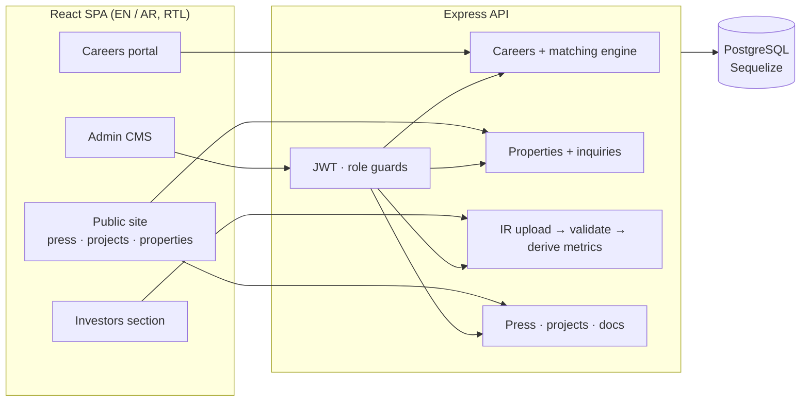
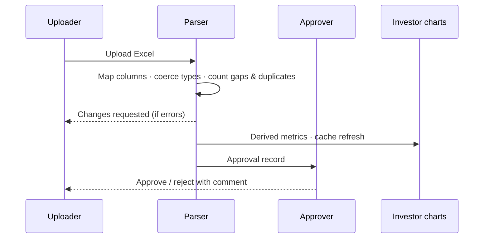

# Real-Estate Group Portal

**Case study.** A bilingual corporate platform for a real-estate holding group in the GCC. It combines the public website with a careers portal and applicant matching, a property sales showcase with lead capture, and an investor-relations data pipeline.

> This repository is a write-up, not the source. The code belongs to the client and stays private.
> I'm happy to give a live walkthrough of the architecture and code in an interview.

| | |
|---|---|
| **Role** | Sole engineer: full stack |
| **Stack** | React 18 · React Router · i18next · Styled Components · Framer Motion · Chart.js · Node.js / Express · Sequelize · PostgreSQL · JWT · Multer · SheetJS |
| **Size** | ~22k lines of JavaScript · 19-model schema · 16 API route modules |

---

## The problem

The group's website had to do much more than show brochures. It needed to recruit (job seekers apply with full profiles, and HR needs a ranked shortlist), sell (property listings that turn visitors into inquiries and viewings), and inform investors (financial figures that start life in internal spreadsheets). All of it had to work fully in English and Arabic.

## What I built

### Bilingual public site
- English and Arabic throughout, with right-to-left layout for Arabic, using i18next.
- A press-release system and project showcase, both managed from an admin CMS.

### Careers portal and applicant tracking
- Candidate accounts with structured profiles (experience, education, certifications, skills) and document uploads.
- HR admin for jobs, applications, status changes and a pipeline metrics view.
- **Weighted candidate matching.** Each job defines mandatory skills, preferred skills, minimum years, location and degree. Candidates are scored with configurable weights and skill synonyms (`js` matches `javascript`, `scrum` matches `project management`). The ranked shortlist can be exported for the hiring team.

### Property sales
- Listings with galleries, text search, and filtering by property type and price range.
- **Lead capture.** Inquiries and appointment bookings are tracked per property.

### Investor-relations data pipeline
- Finance staff **upload Excel files**. A parser validates each file against **admin-configurable column mappings** (display name, required or optional), so changing a spreadsheet layout is a settings change, not a code change.
- Each upload is **profiled on the way in**: missing required columns, missing values and duplicate rows are counted. Files with errors are flagged *changes requested* automatically.
- **Separate uploader and approver roles,** with an approval record and a timeline for every submission.
- Key metrics are derived from the normalised rows to drive the investor charts, and the relevant caches are invalidated on each upload.
- An IR document library with bulk upload, published alongside the figures.

---

## Architecture

### Investor-relations flow

---

*Built by [Fawas Koya](https://github.com/fawaskoya). Client details are anonymized.*
