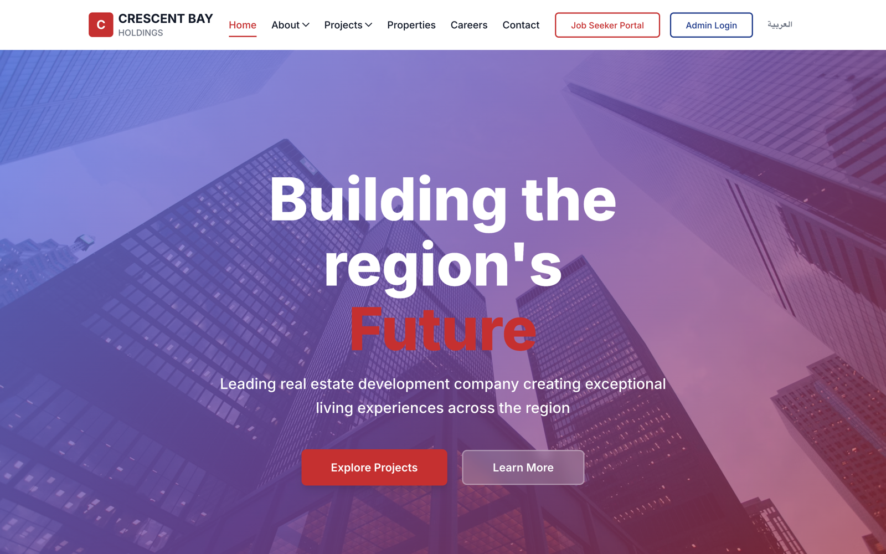
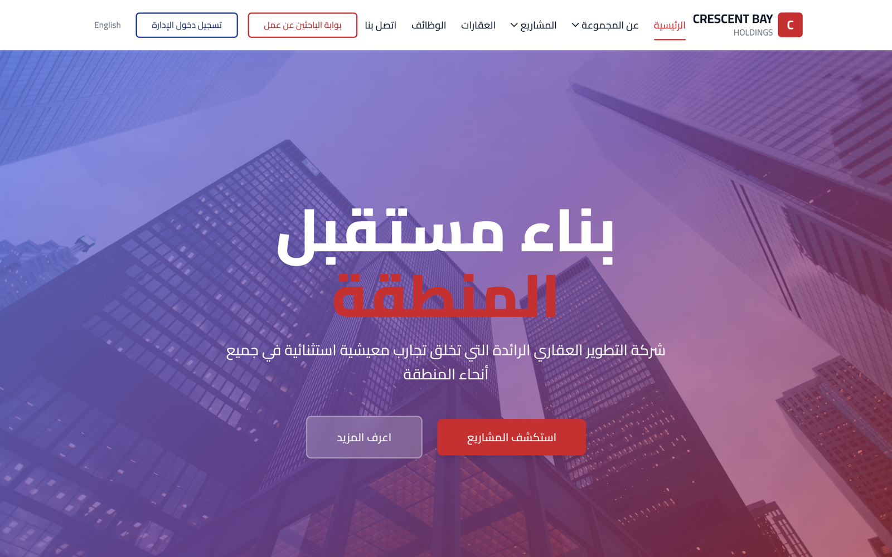
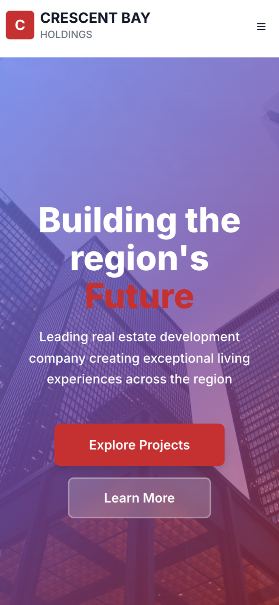
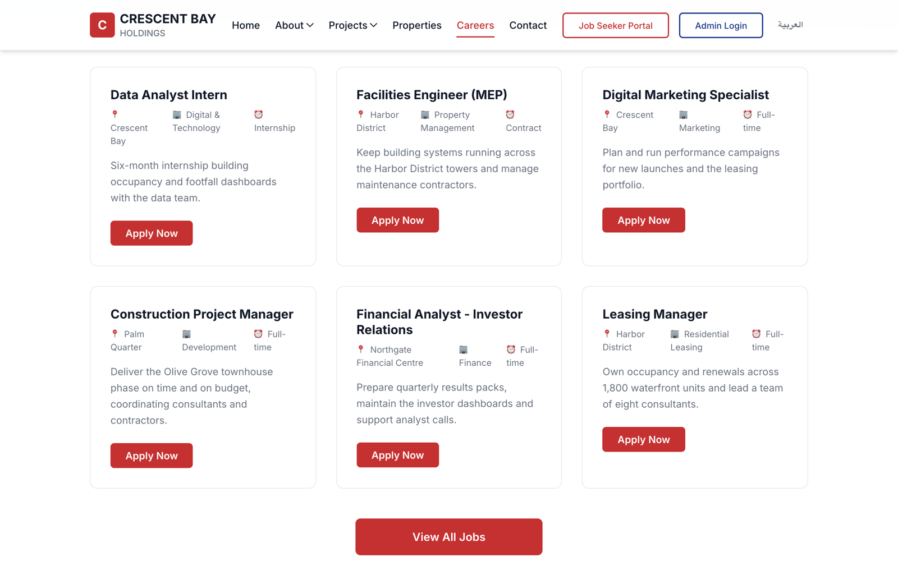
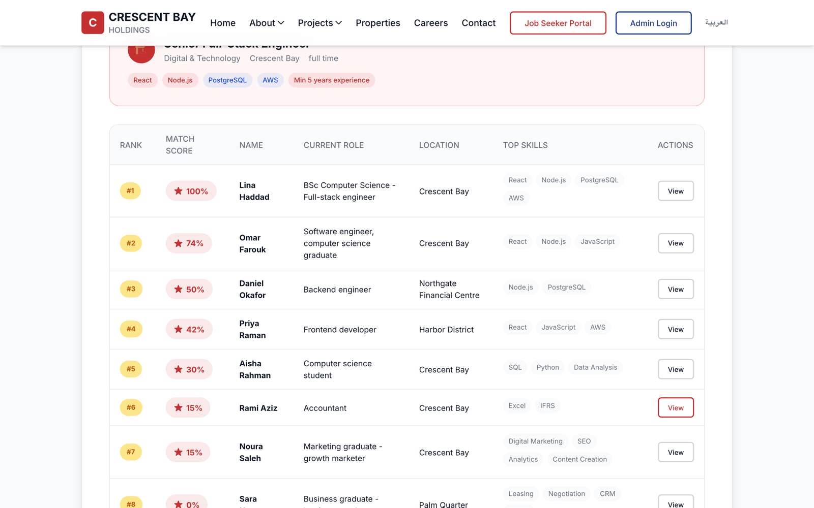
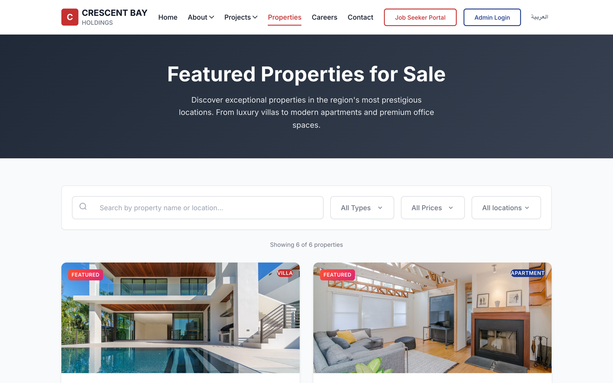
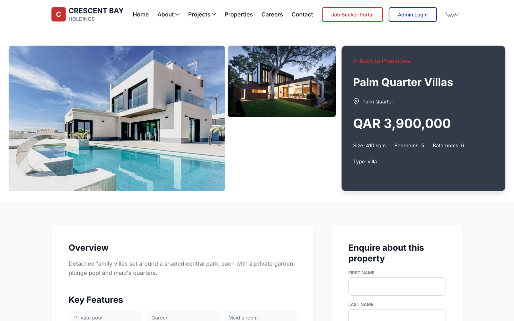
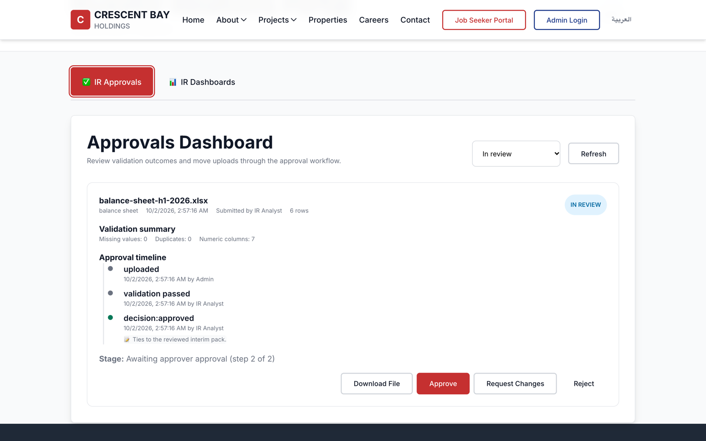
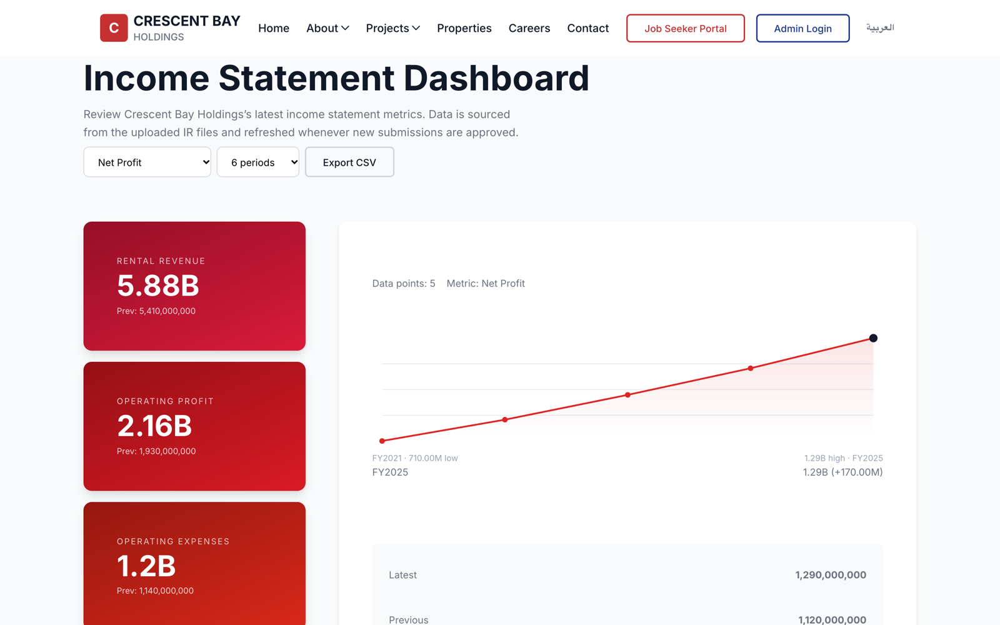
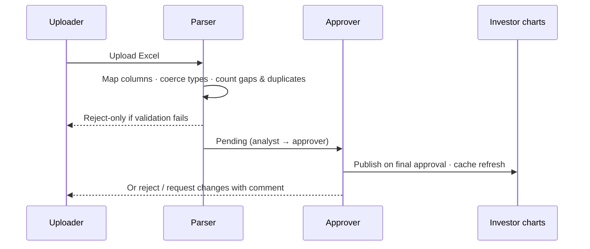

# Real-Estate Group Portal

**Case study.** A bilingual corporate platform for a real-estate holding group in the GCC. It combines the public website with a careers portal and applicant matching, a property sales showcase with lead capture, and an investor-relations data pipeline.

> This repository is a write-up, not the source. The code belongs to the client and stays private.
> I'm happy to give a live walkthrough of the architecture and code in an interview.
> Screenshots use an invented brand ("Crescent Bay Holdings") and invented data.

| | |
|---|---|
| **Role** | Sole engineer: full stack |
| **Stack** | React 18 · React Router 6 · react-i18next · Styled Components · Framer Motion · custom SVG charts · Node.js / Express 4 · Sequelize 6 · PostgreSQL · JWT · Multer · SheetJS · node:test |
| **Size** | ~25.8k lines of JavaScript · 19-model schema · 16 route modules / 95 handlers · 12 server tests incl. a Postgres integration test |

---

## The problem

The group's website had to do much more than show brochures. It needed to recruit (job seekers apply with full profiles, and HR needs a ranked shortlist), sell (property listings that turn visitors into inquiries and viewings), and inform investors (financial figures that start life in internal spreadsheets). All of it had to work fully in English and Arabic.

## What I built

### Bilingual public site
- English and Arabic with full right-to-left layout for Arabic, using i18next (EN/AR locale files with identical key sets).

<table><tr><td width="50%"> Arabic homepage, full RTL.</td><td width="50%"> Mobile layout.</td></tr></table>

- A press-release system and project showcase, both managed from an admin CMS.

### Careers portal and applicant tracking
- Candidate accounts with structured profiles (experience, education, certifications, skills) and document uploads.
- HR admin for vacancies, applications, a searchable CV database and pipeline metrics (status/source counts, average time-to-hire).
- **Weighted candidate matching.** Each job defines mandatory skills, preferred skills, minimum years, location and degree. Candidates are scored with configurable weights and skill synonyms (`js` matches `javascript`, `scrum` matches `project management`). The ranked shortlist can be exported to CSV.

<table><tr><td width="50%"> Careers page fed by the jobs API.</td><td width="50%"> Candidates ranked by the weighted scorer.</td></tr></table>

### Property sales
- Listings with galleries, text search, and filtering by type, price, location and bedrooms.
- **Lead capture.** Inquiries and appointment bookings are stored per property and managed in the admin.

<table><tr><td width="50%"> Listings with filters.</td><td width="50%"> Detail page with inquiry and booking.</td></tr></table>

### Investor-relations data pipeline
- Finance staff **upload Excel files**. A parser validates each file against **admin-configurable column mappings** (display name, required or optional), so changing a spreadsheet layout is a settings change, not a code change.
- Each upload is **profiled on the way in**: missing required columns, missing values and duplicate rows are counted. Files that fail validation can only be rejected.
- **Two-step maker-checker approval** (analyst, then approver) with a full audit timeline. **Nothing reaches the public investor pages until the final approval**; public APIs read published data only, and caches are invalidated on every decision.
- Dashboards for the income statement, balance sheet, fact sheet and ratios, built from derived metrics with custom SVG charts.

<table><tr><td width="50%"> Upload awaiting the approver, with validation summary and timeline.</td><td width="50%"> Public income-statement dashboard (published data only).</td></tr></table>

- An IR document library with bulk upload, published alongside the figures.

---

## Architecture

### Investor-relations flow

## Quality pass (Oct 2026)

A full audit added the first automated tests (unit + a Postgres integration test that drives upload → analyst → approver → public API), gated investor data behind approval, hardened authentication and admin endpoints, fixed crashes in listings, applications and profiles, replaced a mocked job-seeker portal with the real APIs, fixed mobile navigation, and stopped tracking ~66k build/dependency files.

---

*Built by [Fawas Koya](https://github.com/fawaskoya). Client details are anonymized.*
